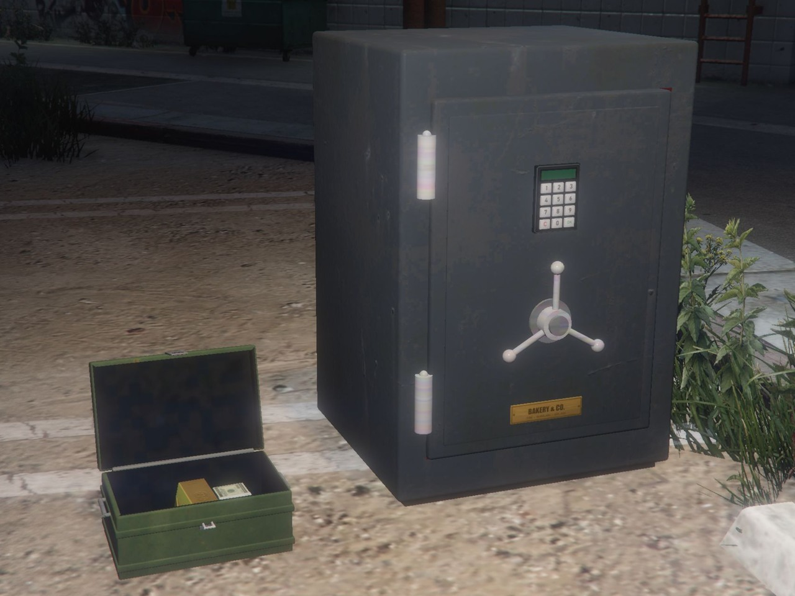
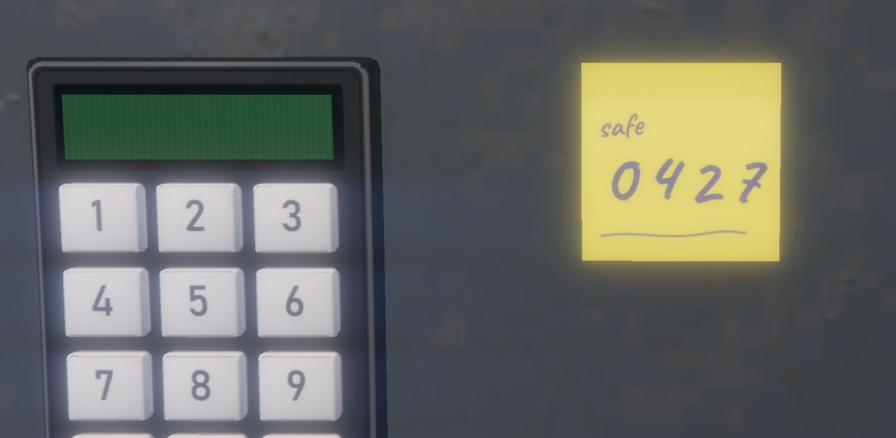
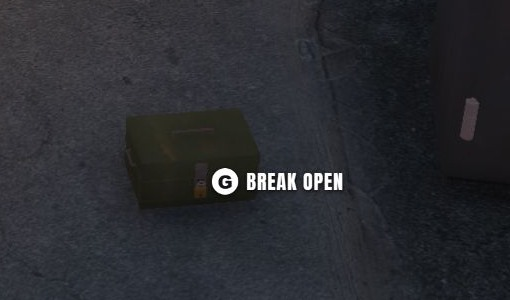
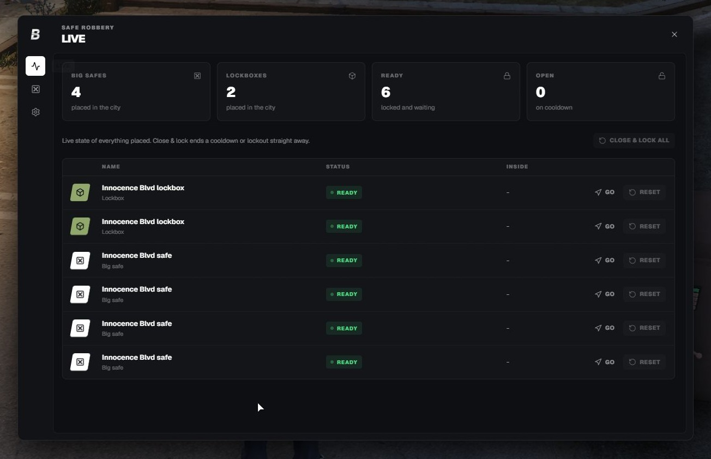

# Bakery Safe Robbery

A GTA VI–inspired FiveM robbery resource with custom safes, padlocked lockboxes, and world-space interactions.



## Features

- **Two ways into a safe.** Find the handwritten code and tap **G** to use the physical keypad, or hold **G** to plant a breaching charge. The hold prompt appears when you carry a charge.
- **Break open lockboxes.** Use the configured tool and complete the padlock interaction to reveal the contents.
- **Loot you can see.** Rewards appear as props inside opened containers. Grab them with your target system, or press **E** when targeting is unavailable.
- **Manage everything in-game.** Use `/saferobbery` to place and test props with a free camera, hide sticky notes, configure rewards and police checks, and manage cooldowns.

## Dependencies

- FiveM FXServer with OneSync enabled. [OneSync documentation](https://docs.fivem.net/docs/scripting-reference/onesync/)
- `ox_lib` for progress bars and skill checks. [Download ox_lib](https://github.com/overextended/ox_lib/releases/latest/download/ox_lib.zip)
- `oxmysql` with a configured MySQL or MariaDB connection. [Download oxmysql](https://github.com/overextended/oxmysql/releases)
- `kq_link` configured for your framework and inventory. Set up a targeting or dispatch integration there if you use one. [Download kq_link](https://github.com/Kuzkay/kq_link/releases)

## Install

1. Download the [install ZIP](https://github.com/TheMuffinMann324/bakery_saferobbery/releases/latest/download/bakery_saferobbery.zip) and extract the `bakery_saferobbery` folder into your server’s resources directory. The ZIP includes the compiled UI.
2. Register `safe_charge` in your inventory, or choose an existing breaching item in the admin settings. Lockboxes use `weapon_crowbar` by default.
3. Add the following to `server.cfg`. The resource creates its tables on first start.

   ```cfg
   ensure ox_lib
   ensure oxmysql
   ensure kq_link
   ensure bakery_saferobbery

   add_ace group.admin bakery_saferobbery.admin allow
   ```

4. Run `/saferobbery` in-game to place your first safe or lockbox. Set that container’s rewards to item names your inventory recognises.

## Screenshots

| Sticky-note clue | Lockbox DUI prompt |
| --- | --- |
|  |  |



<details>
<summary>Build the UI from source</summary>

Run `npm ci` and `npm run build` from `web/`. The admin UI, sticky note, and interaction prompt all build into `web/dist/`.
</details>

Licensed under the [GNU GPL v3](LICENSE). Painted metal uses Rob Tuytel’s [Green Metal Rust](https://polyhaven.com/a/green_metal_rust) texture.
